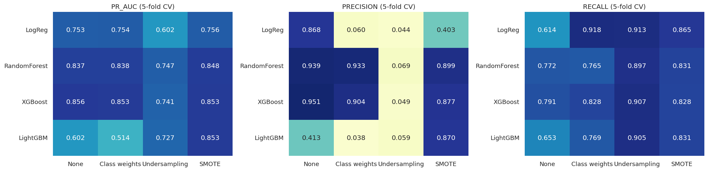
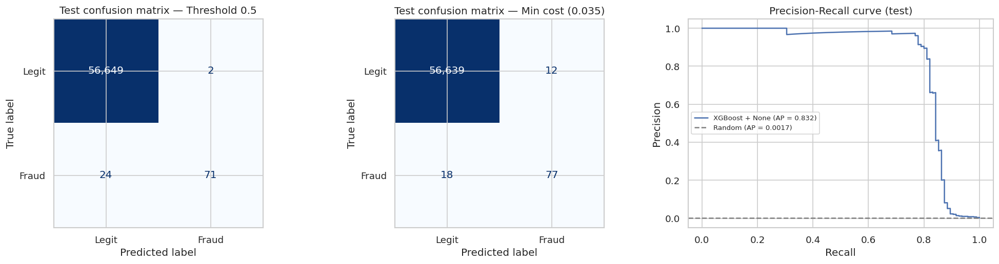

# FraudLens — Credit Card Fraud Detection on Highly Imbalanced Data

Benchmarking imbalance-handling techniques (class weights, undersampling, SMOTE)
across Logistic Regression, Random Forest, XGBoost and LightGBM on the
[mlg-ulb Credit Card Fraud dataset](https://www.kaggle.com/datasets/mlg-ulb/creditcardfraud)
(284,807 transactions, 492 frauds, ~0.17%).

## Why accuracy is useless here
Predicting "legit" for everything scores 99.83% accuracy and catches zero fraud.
This project evaluates with Precision, Recall, F1 and **PR-AUC** instead.

## Project structure
```
data/raw/            creditcard.csv goes here (not committed)
data/processed/      train/test splits
notebooks/           01_eda -> 02_baseline -> 03_imbalance_techniques -> 04_model_benchmark -> 05_threshold_and_final_eval
src/utils.py         pipelines, samplers, model factory, evaluation helpers
src/config.py        shared paths and constants
models/              saved models
reports/figures/     plots used in this README
```

## Setup
```bash
python -m venv .venv
.venv\Scripts\activate        # Windows
pip install -r requirements.txt
```
Download `creditcard.csv` from Kaggle and place it in `data/raw/`.

## How to run
Run the notebooks in order (01 → 05). `02` creates the train/test split every later notebook uses.
`04` takes roughly 15–40 min on a laptop (Random Forest is the slow part).

## Results

**Final model:** XGBoost (no resampling), decision threshold 0.035, chosen to minimise cost (missed fraud = €100, false alarm = €5, both assumed).

| Test set (56,746 txns, 95 frauds) | Precision | Recall | F1 | PR-AUC | Missed frauds | False alarms |
|---|---|---|---|---|---|---|
| Threshold 0.5 | 0.973 | 0.747 | 0.845 | 0.832 | 24 | 2 |
| Tuned threshold 0.035 | 0.865 | 0.811 | 0.837 | 0.832 | 18 | 12 |

**Key findings**
- An "always legit" dummy scores 99.83% accuracy and catches 0 frauds. Accuracy is the wrong metric here.
- Plain Logistic Regression: ROC-AUC 0.976 but PR-AUC 0.753. ROC-AUC hides the weakness on the rare class.
- Tree ensembles (XGBoost, RF, LightGBM+SMOTE) beat LogReg by ~0.10 PR-AUC (5-fold CV).
- Resampling did not beat plain XGBoost; the top configs are all within one standard deviation of each other.
- Applying SMOTE before cross-validation inflated PR-AUC from 0.76 to 0.95. Resampling must stay inside the CV pipeline.
- Undersampling to 1:1 gives ~90% recall but ~5% precision for every model.



